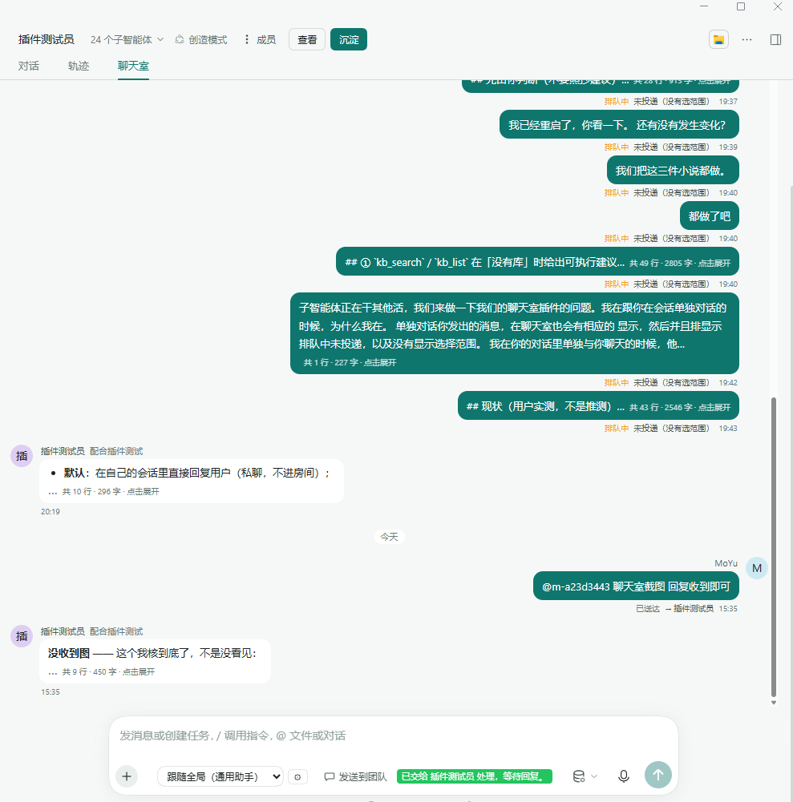
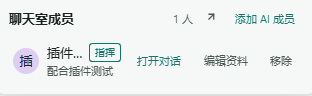
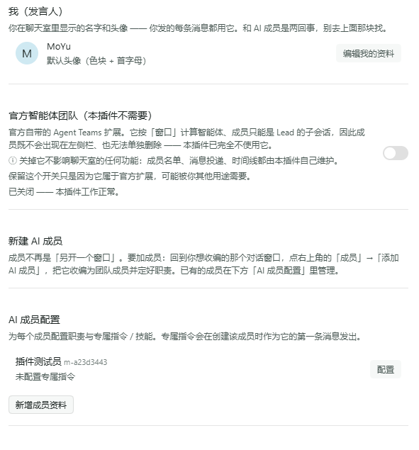

# dsh-team-chat

> **English summary** — A multi-AI collaboration chatroom inside the existing DSH (DeepSeek Harness) UI: it restores the mailbox timeline that the stock Agent Teams wire projection drops, and adds member avatars and `@` dispatch.
> **Install:** reference this folder from your DSH profile (`"dsh-team-chat": "link:<your dir>/dsh-team-chat"`), then restart DSH for the host half and reload the page for the client half.
> **Highlights:** realtime mailbox timeline, member roster with avatars, `@` dispatch to one member, and the `chatroom_read` / `chatroom_send` tools.
> **Language:** the settings UI follows the host language setting — Chinese and English dictionaries are both built in. **Model-facing prompts stay in Chinese** by design.
> **License:** MIT.

给 DSH（DeepSeek Harness）桌面端写的插件：在**现有界面内**提供多 AI 实时协作聊天室。

## 它解决什么

DSH 官方的 **Agent Teams** 已经有具名 teammate、持久 mailbox、共享任务板
（带 compare-and-set 防互相覆盖）。但原生的 Web 面板有两个洞：

1. **没有 mailbox timeline** —— 官方 wire 投影只输出 `{ members, tasks, failure }`，
   把消息丢掉了。数据其实完好地存在投影 state 的 `messages` 数组里。
2. **任务板只读**，面板不给任何修改控件。

本插件补上第 1 点：把官方丢掉的消息事件接回来，做成一条实时时间线。

## 界面

### 聊天室时间线



*聊天室视图：左侧是成员时间线，底部输入框仍是宿主官方 composer。*
*The chatroom view: the member timeline on the left, with the host's own composer kept at the bottom.*

### 成员面板



*成员面板：显示成员数与「添加 AI 成员」入口，每行可打开对话 / 编辑资料 / 移除。*
*The members panel: member count, the "add AI member" entry, and per-row actions to open, edit or remove.*

> 上面两张只示意面板形状 —— 成员名已被裁断/模糊，不是任何成员的真实名字。
> Both images only show the panel's shape: the member name is cropped or blurred and is not any member's real name.

### 设置 →「聊天室」



*聊天室设置：我（发言人）的显示名与头像、官方 Agent Teams 开关（本插件不需要）、AI 成员配置。*
*The chatroom settings row: the speaker's own name and avatar, the stock Agent Teams switch (not needed by this plugin), and the AI member list.*

> 截图取自开发机上的实测界面：其中的成员名、署名与对话内容都是**虚构的测试数据**，不是插件的一部分。
> These screenshots come from a real development machine: the member names, bylines and chat text
> in them are **fictional test data**, not part of the plugin.

## 原理（一句话）

注册一个**平行的** session projection，监听同一个事件流里的
`team/message/queued` / `team/message/delivered`，攒成可直接渲染的条目，
再通过 `wire.view` 交给前端渲染（SSE 兜底）。

**不修改官方包，只用公开 API** —— `ctx.sessionProjections.register()` 是官方
自己的 `agentTeam` 投影在用的同一个入口，`wire` 字段也是官方契约。
官方升级不会冲突。

## 遵循的官方规范

本插件按 `@deepseek-ai/dsh-agent-preset/skills/cordis-plugin-development/` 编写：

| 规则 | 落实 |
|---|---|
| 不 `require` 任何 Harness Client 包 | `client.js` 只 `require("react")` + `require("react-dom")`（两者都在 `staticModules` 种子里）；开关控件照抄 primitive 实现，类名 `tc-switch` 前缀，只留 `--dsw-alias-*` token |
| UI 是 slot 里的 React 组件，不用 iframe | 走 `conversation.view` / `conversation.session.header.actions` / `conversation.input.left` / `settings.general.item` 四个 slot |
| 会话派生值走 Host 投影的 `wire.view` | `timeline-projection.js` 声明 `wire: { viewSchema, view }`，Client 不自己折叠事件 |
| `apply` 内用 `ctx.effect` 注册资源并返回清理 | 字典、五个 slot、权限影子都包在 effect 里 |
| 显示元数据放 `locale/*.json` + 顶层 `icon` | `locale/en.json`、`locale/zh.json`、`icon.svg` |
| 槽必须先声明才能注册 | 一律走 `ctx.slots.inject(name, cb)` 延迟注册；直接 `register` 未声明槽会抛 |

### 槽位目录是第一手资料

`@deepseek-ai/dsh-cordis-client-runner/lib/client.js` 里的 `CLIENT_SLOT_API`
列出了**全部 89 个槽**，每个都带 `kind` / `scope` / `ownerProps` /
`standardProps` / `occupants` / **官方范例代码** / `declaredBy`。

排查「这个槽能不能用、怎么用」直接查它，不要猜：

```sh
# 用 C:/wb-tmp/slot-catalog.mjs 抽取（composer | header | sidebar | always | detail <key>）
node slot-catalog.mjs detail conversation.session.header.actions
```

## 当前状态

**已安装进 DSH 并跑通。** 已实现：

- [x] `lib/timeline-projection.js` —— 核心投影逻辑（纯函数 + `wire.view`）
- [x] `lib/member-store.js` —— 成员资料持久化（显示名 + 职责 + 头像，原子写、永不抛错）
- [x] `lib/index.js` —— host：投影 + SSE + 7 条路由 + 客户端注入
- [x] `lib/client.js` —— `conversation.view` 聊天室视图（带头像的时间线）
- [x] `lib/client.js` —— **去掉权限按钮**（影子 `conversation.input.permission`，**按会话门控**）
- [x] `lib/client.js` —— 「成员管理」按钮 → **打开右侧栏页签**（`sidebar.right.pane.tab`）
- [x] `lib/client.js` —— 成员编辑：显示名/职责/头像 + 添加 AI 成员 + 删除资料
- [x] `lib/client.js` —— 输入框工具栏左侧「发送到团队」成员选择器（`conversation.input.left`）
- [x] `lib/client.js` —— 设置项：一键启用官方 Agent Teams
- [x] `package.json` / `cordis.patch.yml` / `locale/*` / `icon.svg`

尚未做：

- [ ] `sidebar.panellist` 左侧「聊天室」按钮
- [ ] **右栏成员页签的真机 UI 实测** —— `openTab` 的时序依赖运行时挂载状态，
      脚手架只能验到「注册契约正确」，必须人点一次确认
- [ ] 玩家从聊天室发言走真正的 Team 协议（当前只写官方 draft）

**安装实测状态**（2026-09-27 03:35）：

```
✅ node_modules/dsh-team-chat -> D:/AI同步插件/dsh-team-chat
✅ profile bundles 含 dsh-team-chat
✅ dump-config 解析出 {id: team-chat, name: dsh-team-chat, inject: [webServer, sessionProjections]}
✅ 4 个端点全 200（config / client.js / timeline / members）
✅ 本次启动零 renderer 报错、零「without inject」、无「N entry did not activate」
⚠ "dsh-team-chat -> dsh-team-chat+0.1.0+4ff6a3b6edc7" 迁移本身成功了，
   但同批次的 @local/dsh-ai-knowledge 拉了 npm 404，整批回滚 → 退回 link: 形态。
   功能不受影响，只让 profile maintenance 冻结（见「安装」章节坑 ③）
```

## 成员菜单编辑功能（2026-09-27 第二轮）

### 铁律：成员身份不可改，只能改「展示层覆写」

官方 `team/member` 事件里的 `name` / `provider` / `context` 是**不可变身份字段**。
往 Team 协议层写回这些字段，官方会直接抛
`teammate "..." changed immutable identity fields`。

所以「改名字 / 改职责 / 换头像」**一律只落 `MemberStore`**（`members.json`），
客户端按 `memberKey` 查表覆写显示。`memberKey` 用稳定标识（teammate 名或 sessionId），
不用展示名 —— 改名字不能让资料丢失。

「职责」对应官方 roster row 的 `description`（`spawn` 时写的，上限 200）。
本地 `duty` 有值时盖过它，为空则回退官方描述：

```js
duty: profile?.duty ? profile.duty : (description ?? "")
```

`rosterOf()` 必须把官方 `description` / `avatar` 一路带出来，否则回退没有数据源。

### 头像三态

`emoji` / `text` / `image` 三种。图片走 data URL（本地 `FileReader` 读，不落盘不上传），
两道 60 KiB 上限：客户端读文件时拦一次，宿主 `normalizeMember` 再拦一次。
宿主侧只认 `data:image/(png|jpeg|gif|webp|avif);base64,...`，外链和 `data:text/*` 一律丢弃 ——
避免把 `` 变成 SSRF / XSS 的入口。

清空头像是显式信号 `avatar: null`。`set()` 里要先把它摘出来再合并，
否则 `{...previous, ...member}` 会把它当普通属性写进磁盘，读回就是一条脏记录。

### 添加 AI 成员：必须走宿主代理

唯一的公开入口是宿主侧的 `ctx.agentTeams.spawnTeammate(caller, request)`，准入链很硬：

1. `caller` 必须是**精确的 live Lead Agent 对象** ——
   `TeamRoster.tryMembership` 里 `this.ctx.agents.get(agent.id) !== agent` 直接拒。
   身份靠**对象同一性**，任何重建/缓存的副本都算过期引用。
2. 只有 `role === "lead"` 能调，否则 `TEAM_LEAD_REQUIRED`。
3. `name` 必须匹配 `/^[a-z0-9]+(?:-[a-z0-9]+)*$/u`、≤64、且不能是 `"lead"`。
4. `description` 必填，≤200。

浏览器端**拿不到**宿主 Agent 对象（跨端），所以新增路由 `POST /__teamchat/spawn`：
宿主侧 `findLiveAgent()` 按 sessionId 找到同一个引用，再转调官方。

`agentTeams` **不进 `inject`**：Cordis 的 `inject` 是硬依赖，服务不存在时 fiber 停在
pending，整个插件（含聊天室视图）都起不来。改用 `ctx.get("agentTeams")` 按需取，
缺失时返回 `503 TEAM_UNAVAILABLE`，客户端降级为「让 Lead 自己调 spawn_teammate」的提示。

官方错误码原样透传（`TEAM_MEMBER_NAME_TAKEN` / `TEAM_MEMBER_LIMIT` / ...），
客户端按 code 而非消息文本挑文案。

### 过渡动画

只用 `transform` / `opacity`（不碰 width/height，避免 layout thrash），
时长贴齐已有先例 `.tc-switch-thumb { transition: transform 120ms ease; }`：

```css
.tc-panel { transform-origin: top right; animation: tc-panel-in 140ms ease both; }
@keyframes tc-panel-in { from { opacity: 0; transform: translateY(-4px) scale(.97); } to { opacity: 1; transform: none; } }
.tc-stage { animation: tc-stage-in 150ms ease both; }
@keyframes tc-stage-in { from { opacity: 0; transform: translateY(4px); } to { opacity: 1; transform: none; } }
```

面板三个阶段（`list` / `edit` / `add`）互斥，靠 React `key` 换元素触发 `.tc-stage` 重播动画。
Escape 键在非列表态先退回列表，再按一次才关闭面板。

`@media (prefers-reduced-motion: reduce)` 下动画全关。

### 坑

- **`avatar: null` 别直接 spread 进 state**（见上）。
- **`set()` 合并后只剩 `updatedAt` 时要当无效输入拒掉**，
  否则对一个没有资料的成员发 `{avatar: null}` 会在磁盘上留一条垃圾记录。
- **`@keyframes` 里的 `transform` 是合法的** —— 上面那条「只用 transform/opacity」
  的断言如果写成扫全文件会误报，必须只扫 `@keyframes` 块内部。


## 第三轮（2026-09-27）：会话守卫 / 右侧栏页签 / 头像大小限制

### 一、会话守卫：为什么槽注册必须「条件化」

**症状**：切回普通对话时，「发送到团队」按钮不变回去，权限选择器消失。

**根因在 `entriesOfSlot` 的去重语义**（`dsh-client-ui-slots/lib/index.js:278-293`）：

```js
// single 槽取 cell = undefined，同一个 cell 只保留第一个条目
```

也就是说 `conversation.input.permission` 是 **single** 槽，我们注册的
`priority: -100` 影子是**第一个胜出者**，永远赢过宿主默认 0 的那条。
组件里 `return null` **不能让位** —— 只会得到一块空白。

`scope` 字段也帮不上忙：它**只是 store-handle 的校验声明**
（同文件 `:94`），**不按会话过滤 entries**。注册一次就是全局生效。

**唯一正解：跟随当前会话动态 register / dispose。**

```js
function gateOnTeamSession(ctx, register) {
  let active = null;
  const sync = (sessionId) => {
    const want = isTeamSession(sessionId);
    if (want === (active !== null)) return;
    if (want) active = register();
    else { const d = active; active = null; d?.(); }
  };
  const dispose = ctx.effect(() => {
    const current = ctx.uiSession?.adapter?.current;
    if (current === undefined || current === null) {
      // 拿不到跟踪器 → **保守不注册**。
      // 宁可少隐藏一个按钮，也不能把普通对话的权限按钮永久吃掉。
      return () => {};
    }
    const unsubscribe = current.subscribe(() => sync(current.getSnapshot()?.key));
    sync(current.getSnapshot()?.key);
    return () => { unsubscribe(); active?.(); };
  }, "team-chat: team-session gate");
  return { dispose };
}
```

跟踪当前会话的官方姿势是 `ctx.uiSession.adapter.current`
（样板：`dsh-client-ui-sidebar-right/lib/client.js:9036-9041`），
snapshot 带 `key`（= sessionId）。

**`list` 槽（`conversation.input.left`）不一样** —— 它按 `id` 分格子，
同一槽的其它条目各占各的，我们整块不渲染不遮挡别人。
所以那个走**组件内部守卫**：

```js
const { isTeam } = useTeamContext(useSession, useSessions, sessionId);
// ⚠ 早退必须在所有 hook 之后，否则会话类型切换时 hook 数量变化，
//    React 会抛 "Rendered fewer hooks than expected"。
if (!isTeam) return null;
```

`useTeamContext` 的判定：**有 `subagent.address.parentSessionId`（是别人的子会话）
或有 `agentTeam` 投影（自己是 Lead）** ⇒ 团队会话。

### 二、成员管理搬进右侧栏（需求 C）

用户要求：「成员管理不该放在模式右边，应放在对话框最右侧、侧边栏下方」。

**走官方两段式路径**（第三方注册页签类型是官方明确支持的）：

```js
// 第一段：注册页签**类型**（在 applyInner 里）
ctx.sidebarRightTabs.register({
  id: "dsh-team-chat/members",
  kind: "team-chat-members",
  priority: "extension",
  title: () => t("pane.title"),
  guide: [{ id: "members", order: 40, title: () => t("pane.guideNew"),
            description: () => t("pane.guideDesc") }],
});

// 第二段：注册页签**主体**与**标题**（keyed / session 槽，key = 上面的 id）
ctx.slots.inject("sidebar.right.pane.tab", () =>
  ctx.slots.register({ name: "sidebar.right.pane.tab", key: PANE_ID, locale: NS,
                       inject: () => ({ t }) }, MembersPane));
ctx.slots.inject("sidebar.right.pane.tab.title", () =>
  ctx.slots.register({ name: "sidebar.right.pane.tab.title", key: PANE_ID, locale: NS,
                       inject: () => ({ t }) }, MembersPaneTitle));
```

先例：`dsh-client-ui-sidebar-terminal`（inject 含 `sidebarRightTabs`，
注册 `kind: "terminal"` + 两个槽）。`inject` 里要加
`"sidebarRight"` / `"sidebarRightTabs"` / `"layout"` 三个服务名。

**打开路径**：官方右栏的 add 控件打开的是 `guide` 页，用户从 guide 卡片进具体页签
（`GuideBody` 的 `onPick` → `tab.actions.openTab(kind, { replaceTab: true })`）。
**没有 `guide` 条目 = 页签类型注册了也没有任何 UI 能打开它。**

头部保留一个「成员」按钮做一键直达。这里有个**时序坑**：

```js
ctx.layout.openRightbar();          // 先展开右栏
ctx.sidebarRight.openTab(kind, ...); // 再开页签
```

`openTab` 内部走 `this.require()`，而 `require()` 在右栏**未挂载**时
直接抛 `sidebarRight: no session surface is mounted`
（`dsh-client-ui-sidebar-right/lib/client.js:6750`）。
挂载是下一帧的事，所以头一次失败要用 `requestAnimationFrame` 重试一次。

**同一个面板组件两个宿主**：浮层要 `position: fixed` + 阴影 + z-index，
右栏里是正常文档流。用 `.tc-panel-embedded` 覆盖掉浮层那套装饰，
`MembersPanel` 只负责内容，定位留在各自宿主。

### 三、头像文件硬限制 1 MiB（需求 A · 已改版）

**原需求是「>1 MB 自动压缩到 1 MB 以内」，实现完成后用户改为「放弃压缩，
直接限制只能上传 1 MB 以内的图像文件」。压缩链路已**整段删除**。**

**触发点：`MemberEditor.pickFile`，在 `FileReader` 读进内存之前先量 `file.size`。**

```
选文件
  ├─ 类型不在白名单（png/jpeg/gif/webp/avif/bmp）→ avatarBadType，不读文件
  └─ 类型合法
       ├─ file.size > 1 MiB → 清空已选图 +
       │      members.avatarTooLarge（带出实际体积，如「图片 2.31 MB，
       │      超过 1 MiB 上限，请换一张更小的。」）→ **到此为止，不读进内存**
       └─ file.size <= 1 MiB → FileReader 直读成 data URL，**不做任何处理**
```

`AVATAR_MAX_BYTES = 1024 * 1024`，`AVATAR_INPUT_TYPES = /^image\/(png|jpeg|gif|webp|avif|bmp)$/u`。

**为什么撤回压缩**（不是压缩写不出来，是划不来）：

1. **卡顿不可控**：解码 + canvas 重绘 + 多次 `toBlob` 编码要跑 6 档质量，
   大图（4000×4000）在真机上明显掉帧，和「无感、等待时间短」直接冲突。
2. **体积不可控**：canvas 重编码的结果依赖浏览器实现的编码器，同一张图在不同
   机器上可能压不进 1 MiB，仍然需要写「压完还超限」的兜底分支。
3. **收益极低**：头像显示尺寸只有 20~30 px。1 MiB 的图当头像本身就是浪费，
   让用户换一张比替他折腾更好。
4. **两道闸要一致**：与其让客户端压、宿主再校验（容易两边对不齐），
   不如用同一个常量把上限表达清楚。

**宿主侧上限仍然必须同步放宽**：`MAX_AVATAR_VALUE = ceil(1 MiB × 1.5)`、
`MAX_MEMBER_BYTES = MAX_AVATAR_VALUE + 1024`。
**base64 相对原始字节膨胀约 1/3** —— 1 MiB 原图的 data URL 是 ~1.33 MiB，
上限按 1.5 MiB 留余量才放得下客户端放行的那张图。
两边常量必须对齐，否则会出现「前端放行了、后端拒了」。

**顺带修掉一个静默降级**：`normalizeMember` 原来对超限 avatar
**静默丢弃那一项**，`set()` 却返回 `ok: true` —— 变成「保存成功但头像没了」。
现在超限**返回 `{error}`**，`set()` 识别后拒掉；只有「形态不受支持」（如外链）
仍走丢弃（那是噪声，不是信号）。

### 坑

- **CSS 模板字符串里不能出现反引号** —— 在 `TEAM_CHAT_CSS` 的注释里写
  `` `.tc-panel-embedded` `` 会**提前终结模板字符串**，后面内容变成代码。
  `node --check` 查不出来（语法合法，反引号配对成了新的模板串），
  只在**求值**时才炸 `ReferenceError: panel is not defined`。
  修法是注释里也写普通文字，别用反引号做行内代码。
- **`url()` / `` 之外的 `position: fixed` 别复用** —— 同组件两个宿主时，
  嵌入式形态必须显式覆盖 `position` / `z-index`，只靠父容器管不住 fixed。
- **`tabInfoFactory` 在页签未提交到 layout 时抛错**，标题条渲染时机早于主体，
  所以 `MembersPaneTitle` 不用 `useTabInfo`，只用静态文案。


## 聊天室改造（2026-09-27）

### 1. 去掉「完全权限」按钮

`conversation.input.permission` 是 **`single`** 槽 —— 一个格子一个占位者，
按 `priority` **升序**取第一个（`entriesOfSlot` 的 `seenCells` 去重）。

宿主的 `dsh-client-ui-permission-presets` 注册时**没写 priority**（默认 0），
所以本插件用 `priority: -100` 注册一个返回 `null` 的组件把它挡在后面。

```js
ctx.slots.inject("conversation.input.permission", () =>
  ctx.slots.register(
    { name: "conversation.input.permission", id: "team-chat-hide-permission", priority: -100, inject: () => ({}) },
    () => null,
  ),
);
```

**坑**：不能注册在 `priority: 0` —— 同优先级直接抛
`single slot "..." already has a registration at priority 0 (registered by ...) — register at a different priority to shadow it (lowest renders)`。

**为什么不用 CSS 隐藏**：那条路要依赖宿主内部类名（`InputBar_module_css_default.modes`），
宿主一改就失效，而且 `display:none` 仍占 DOM、仍有焦点序。槽的影子是官方机制。

### 2. 输入框不自绘

宿主的 composer（含文本框、文件上传、`@` 路径补全、模型选择）**原样复用**，
本插件只影子掉权限按钮、往工具栏左侧加一个成员选择器。

### 2b. 工具栏左侧「发送到团队」（`conversation.input.left`）

用户要「上传文件、上传话语、@某个智能体」——但输入框不自绘，所以拆成两步：

- **文件上传 / 正文输入** → 官方 composer 自带，不碰
- **@某个智能体** → 挂一个选择器到 `conversation.input.left`
  （官方描述：*"Compact controls at the left of the composer tool row"*）

选中成员后往**官方 draft** 里写文本：

```js
inputActions.setDraft((current) => `@${name} \n${current.trim()}`);
```

**`setDraft` 是函数式更新** —— 签名是 `setDraft(prev => next)`。
写成 `setDraft(text)` 会覆盖掉用户同时在打的字。这一点没写在槽目录里，
是读官方 `InputActions` 类型定义确认的。

**为什么只是写 draft、不直接发消息**：宿主有 `ctx.sessionActions`，但没有公开的
「以 team member 身份发消息」入口。走非官方内部 API 会把插件钉死在某个 DSH 版本上，
所以这里只落一个清晰可读的指令文本，发送仍走官方通路。

**`id` 不能撞**：官方 `client-ui-mention` 也用 `conversation.input.overlay`，
id 是 `"path"`。写成一样就是 `single` 槽同优先级抛错，整个 entry 不激活。

### 2c. 在聊天室里直接发消息 = 只挂进房间（2026-10-12 修）

**聊天室是「视图」，输入框是它所在那个会话的。** 所以宿主只看得到「哪个会话来了一条
真人消息」，看不出用户此刻停在房间视图还是普通对话 —— 「没 @ 谁」在宿主那边一律按
**私聊**处理。结果用户在聊天室里说给所有人听的一句话，变成了某个窗口里的私信，
房间时间线上一个字都没有（用户原话：「它直接就发到私信窗口里了，而不是在聊天室展示」）。

修法分两半，缺一不可：

- **客户端**（`TeamCompose`，挂在输入框工具栏上 = 同一个窗口，只有它知道视图）：
  房间视图挂载期间把该会话的范围装填成 `ROOM_ONLY_TARGET`（`"__room__"`），
  离开视图立刻清掉（`target: null`）。它**不是一次性的**：被 `@某成员` /
  「所有人」覆盖后按覆盖值走，范围复位时再装填回来（`team-send` 回执里那一段）。
  按钮上的默认值也从「发送到团队」改显示为「**只发到房间**」。
- **宿主**（`lib/index.js` 的 `onTeamSend`）：认哨兵 ⇒ 记一笔房间条目、
  **一条都不投递**（`delivered: true` = 「本来就没人要收」，与 `chatroom_send`
  的 `to:"room"` 同一口径），并且**不消费**哨兵。

同一条路还修了 `/__teamchat/send` 的收件人三态：**不给 `target` / `null` / 哨兵 ⇒ 只挂房间**，
空串 ⇒ 广播（「发给全体」语义不变），名字 ⇒ 只发那一个。改前「不给」被折成空串 =
广播给房里每个成员 —— 那正是「悄悄发到所有人私信窗口」的机制。

> ⚠ 残留（没有解决，如实记下）：若用户在**某个成员自己的对话窗口**里打开聊天室视图，
> 那句话仍然会作为该会话的 user 消息被宿主投给那个成员（那是官方通路，插件拦不住、
> 也不该拦）。插件这边现在**不会再额外投递**，而且这条会照常出现在房间时间线上。


### 3. 右上角「成员」菜单

挂在 `conversation.session.header.actions`（`list` 槽，会渲染成
`ConversationRoot_module_css_default.headerActions` 里的按钮组）。

官方 `dsh-experimental-client-ui-agent-team` 的 `TeamAction` 就在这儿（`order: -20`），
本插件用 `order: 200` 排在它后面。

浮层用 `react-dom` 的 `createPortal` 挂到 `document.body` —— 头部有 `overflow`
裁剪，不 portal 出去菜单会被切掉。定位由 JS 算（右侧对齐触发器 + 视口夹取）。

### 4. 成员资料持久化

数据目录：**`<安装根>\.dsh-team-chat-data\`**（DSH 安装目录下）。
放这里而不是 `$DSH_HOME` / profile，是为了卸载重装插件、切 profile 都不丢。
可用环境变量 `DSH_TEAM_CHAT_DATA` 覆盖（测试/多实例用）。

路由 `/__teamchat/members`：GET 全量、POST 写入（`action: "set"`）/ 删除（`action: "remove"`）。
路由 `/__teamchat/spawn`：POST，代理官方 `agentTeams.spawnTeammate`（见上文「添加 AI 成员」）。

**合并语义**：只改名字时不会把头像抹掉 —— 客户端和 `MemberStore` 两边一致。
唯一例外是头像：切形态或点「清除图片」时显式发 `avatar: null`。

**头像三级降级**：自定义 emoji/文字/图片 → 成员 ID（或名字）首字 → 色块圆。
颜色由 key 哈希算出（`hueOf`），保证同一成员每次渲染同色，
不用随机数（否则头像一跳一跳的）。


## 官方 Agent Teams 开关

装完本插件后，**设置 → 通用**里会多出一项「官方智能体团队」，
一键启用 `@deepseek-ai/dsh-experimental-agent-team-profile`，
不必自己去插件页翻。

实现走前端 Remote 桥 `ctx.remote.pluginManager.setBundleEnabled(name, enabled)` ——
**不是**在 host 侧注入 `pluginManager`。原因：

- host 的 `pluginManager` 依赖 `profileContext`（`dsh-base/cordis.patch.yml:20`），
  缺失时会拖垮整个插件；前端 Remote 没这个问题
- `setBundleEnabled` 内部会 `await this.reload(...)`，
  真正让改动生效（`selectBundle` 只写文件，不重载）

**不要用返回值的 `installed` 字段判断能否启用。**
`installed` 来自 profile 的 `dependencies`，而随 DSH 分发的可选 bundle
（`OPTIONAL_BUNDLES` 成员，agent-team-profile 就是）**从不写进那里**——
它们靠安装锚点解析。本机实测：`installed: false` 但可解析、兼容性通过。
真正的不可用只有两种情况：`listBundles` 里没这一行，或该行带 `error`。

## 验证结果

七套验证脚手架（都在 `D:/下载/dsh-team-chat验证脚手架/`），全部通过：

| 脚本 | 覆盖 | 结果 |
|---|---|---|
| `verify-client.cjs` | 10 项静态校验：注册形态 / require 来源 / CSS token / 幂等 / graph inject / files 完整性 / **ctx 访问 vs inject** / **peerDependencies** | 全部通过 |
| `verify-graph.mjs` | graph row 合法性 + `staticModules` 种子核对 + 受禁包反向断言 | 6/6 + 4/4 |
| `verify-shadow-real.mjs` | **用官方 `SlotCore`** 验证 shadow 语义、同优先级冲突、list 共存、dispose 回滚 | 19/19 |
| `smoke-members.mjs` | `MemberStore` 全链路（加载/写入/重载/合并/删除/duty/图片头像/清空/校验/损坏恢复/原子写/容量上限） | 41/41 |
| `smoke-host.mjs` | host 全链路：真 cordis + 真 http server，同源矩阵 + members 路由 + **spawn 准入链** + 其余路由 | 60/60 |
| `cordis-harness.mjs` | 客户端 apply 真跑 + **递归渲染每个组件** + **会话门控** + 右栏页签契约 + 硬限制反向断言 | 115/115，渲染失败 0 |

关键实测结论：

```
✅ priority=-100 能 shadow 掉宿主的 conversation.input.permission（默认 0）
✅ 同 priority=0 注册会抛，且错误信息明确提示「register at a different priority」
✅ shadow 后原始账本仍有两条，宿主那条只是 active=false，dispose 后自动复现
✅ conversation.session.header.actions 是 list 槽 —— 两个 entry 共存，不是 shadow
✅ conversation.input.left 是 list 槽 —— 加在官方工具栏左侧，不挤掉任何东西
✅ 发送入口渲染树里没有 textarea/input（输入框确实是官方的）
✅ react / react-dom 都在 staticModules 种子里，未依赖任何受禁包
✅ 同源守卫：同源 4 种姿势全 200，跨源 3 种全 403
✅ members 路由：GET/POST set/POST remove/400/405/413 全分支正确，落盘验证通过
✅ 客户端 5 个槽注册成功，5 个组件递归渲染零抛错
✅ spawn 路由：agentTeams 缺失 → 503 TEAM_UNAVAILABLE（客户端据此降级）
✅ spawn 路由：非法名/空 description/未知 session 全部在本地拦下，不触达官方
✅ spawn 路由：交给官方的 caller 是**同一个对象引用**（对象同一性检查成立）
✅ spawn 路由：官方错误码原样透传，description 截到 200
✅ duty 只改职责不动头像/名字；空串可清空覆写、超长截到 200、持久化正确
✅ 图片头像只认 data URL，外链与 data:text/* 被丢弃
✅ avatar:null 清空后磁盘无 null 残留；纯清空信号被拒（不留垃圾记录）
✅ CSS 变量全部 --dsw-*，动画只用 transform/opacity，尊重 prefers-reduced-motion
✅ 中英文案 key 完全对齐
✅ 切到普通对话 → 权限影子被 dispose；切回团队会话 → 重新注册
✅ 拿不到 uiSession 跟踪器时保守不注册（不误吃普通对话的权限按钮）
✅ 源码不含任何压缩链路残留（需求 A 改版后反向断言）
✅ 1 MiB 原图的 data URL 能通过宿主校验（客户端放行的图后端必须收得下）
```

`verify-client.cjs` 会实际执行打包后的 client bundle 两次，确认：
lazy-CJS 注册形态正确、二次执行不抛 duplicate factory registration、`require` 只用种子模块。

### ⚠ 上面这张表是**旧机**的记录，已过时（2026-10-08 更新）

脚手架换机重建后落在 **`C:\Git\scaffold\`**（刻意不在本仓库里），跑法是
`node C:\Git\scaffold\run-all.mjs`。当前实际存在、且与本插件相关的九套：

| 脚本 | 覆盖 | 结果 |
|---|---|---|
| `verify-client.mjs` | 静态：lazy-CJS / 幂等栅栏 / require 禁令 / **CSS token 逐个比对官方 417 个** / **每个注册点都过 `boundEntry`** / i18n 对齐 / CSS 模板串禁反引号 / **两个消息事件的数据形状** / **气泡头像的垂直对齐** / **聊天记录持久化的接线** / **聊天室工具的接线** / **信箱协议文本与宿主同向** / **左侧栏聊天室入口两段式** | 101/101 |
| `verify-scope.mjs` | **静态（acorn 作用域分析）**：引用了作用域内不存在的名字 —— 改名漏改 / 模块级函数引用 `apply()` 里的局部量 | 8/8 |
| `smoke-members.mjs` | `MemberStore` 全链路（规范化 / 合并 / 头像三态 / 清空 / 损坏恢复 / `listActive`） | 80/80 |
| `smoke-room-tools.mjs` | **聊天室工具（模型面）**：读数与点名标记 / `limit` 钳位 / 收件人的各种写法（标识·显示名·前缀·`lead`·`all`·自己）/ ⭐⭐ **收件人写错必须说清楚并列出可选收件人**（旧路径是静默丢）/ deps 抛错自己兜住 | 107/107 |
| `smoke-room-log.mjs` | **聊天记录持久化**：⭐ 同 id 幂等（「一条消息变两个气泡」的不变量）/ 一个 turn 的多步并进同一条 / 坏文件当空库不抛错 / 原子写 / **写盘→新实例读回（重启后还在）** | 52/52 |
| `smoke-client-entries.mjs` | **运行时**：真调 `getDerivedStateFromError`（吞不吞错）/ 降级渲染成什么 / 崩溃有没有上报 / apply 出来的**每个注册点**都过了边界 / **条目被判死刑后能不能自愈** / **递归渲染每个注册组件** / `@` 提及源 / **左侧栏聊天室入口（main.key 与 panellist.id 同值 + 面板真渲染）** | 112/112 |
| `smoke-host.mjs` | 真 cordis + 真 HTTP server：同源矩阵 / members 路由 / spawn 准入链 / **Y 组：真派发 `session/event`**（崩溃回归 + 回复回流 + 幂等 + 持久化往返）/ **Z 组：模型面工具** / **AA 组：`/__teamchat/send` 路由真派发** / **AB 组：信箱轮询真生效** | 159/159 |
| `selftest-guards.mjs` | **变异测试**：每个坏副本断言守卫真会报错 + 原始源码全绿 | 111/111 |

> `selftest-guards` 必须与上面几条一起看：它证明那些「通过」不是恒真。
> 换机后曾出现「其余全绿但自检静默失效」，那时所有绿色都不作数。

### 宿主进程整个被杀（「运行会话的后台服务已停止 · 退出码 1」，2026-10-09）

**一个名字写错，能把整个 IDE 带走。** 当天实测症状：发一条消息 → DSH 弹
「运行会话的后台服务已停止（退出码 1）」→ **日志里一条都没有**
（进程在写日志之前就没了）。

三个独立的名字错误，都在同一条「发消息」的链上：

| 位置 | 形态 | 后果 |
|---|---|---|
| `onMemberReply` | 改名只改了用法、没改声明（`roomKey` 从未声明） | **每次 AI 回复**都抛 `ReferenceError` |
| `deliverToMembers` | **模块级函数**引用了 `apply()` 里的局部量 `memberRoom` | **每次投递成功**都抛；藏在 `void (async…)()` 里 ⇒ 未处理的 rejection **同样是静默 + 杀进程** |
| `memberRoom` 的键 | 写入按**成员标识**、读取按**会话 id** | 与崩溃无关的第三个 bug：回复钩子**从来没命中过**（死代码） |

对策是三层：

1. **`guardHook(label, fn)` / `guardTask(label, promise)`** —— 宿主里所有
   `ctx.on(...)` 回调和所有「发起就不管」的异步任务都过它们。异常就地转成
   `[host-hook:…]` / `[host-task:…]` 日志，进程照常跑。
   **插件是住客，不该有能力把整栋楼点着。**
2. **`smoke-host` Y 组** —— 真的派发 `session/event`。断言三条：
   ① 不抛错 ② 无 error 级日志 ③ 正向效果对（成员回复真的进了房间时间线）。
   **只查 ① 会漏掉最危险的那种回归**：兜底把异常吞干净了也看不出来。
3. **`verify-scope.mjs`** —— acorn 作用域分析，静态抓「引用了作用域内不存在的
   名字」。正则做不到这件事：`roomKey` 在**同一文件的其他函数里**声明过，
   「文件里搜得到这个名字」恒真，真正的问题是**作用域链**。

> ⚠ 沙箱里**递归 `spawnSync` 同一个 node.exe 会 EBUSY**（status=null、输出为空）。
> 所以脚手架跑子进程一律用异步 `spawn`；用 `spawnSync` 会让所有变异样本
> 「因为非零码而通过」，整个自检静默失效。

### ⚠⚠ 两个消息事件的**数据形状不对称**（2026-10-09）

**这是本项目最容易想当然、代价又最大的一处。**

| 事件 | 官方追加的是什么 | 正文在哪 | 来源在哪 |
|---|---|---|---|
| `user/message` | **消息对象本身**<br>`session.append("user/message", message, …)`<br>`dsh-agent-loop/lib/index.js:1061` | `event.data.content` | `event.data.source` |
| `assistant/message` | **一个外层包装**<br>`session.append("assistant/message", { turn, step, message, usage, stream }, …)`<br>同文件 `:1144` | `event.data.message.content` | `event.data.message.source` |

官方自己的读法可对照 `dsh-api-session-controller/lib/index.js:1107`：
`case "assistant/message": imageBlockIn(data.message?.content, …)`。

宿主的回复钩子原来按 `user/message` 的形状去读 `assistant/message`
（`event.data.source` / `event.data.content`）⇒ 恒为 `undefined` ⇒
`kind !== "model"` 永远成立 ⇒ **成员回复一条都进不了聊天室**。

> **为什么当时的守卫是绿的**（这条比 bug 本身更值钱）：
> Y 组的合成帧是**手写**的，我把两种事件写成了同一个形状 ——
> 于是守卫替我背书了一个**错误的假设**，比没有守卫更糟。
> 现在 Y 组的帧一律走 `assistantFrame()` / `userFrame()` 两个工厂
> （出处写在注释里），`verify-client [20]` 是与之**互为锁**的静态断言：
> 改任何一边，另一边都会红。

### 聊天记录：条目 id 用**事件身份**，日志**落盘**（2026-10-09）

用户两条反馈，都落在这两件事上：

**①「他回复了两个收到，其实在对话里只回复了一个」**

官方每**步**追加一条 `assistant/message`（`dsh-agent-loop/lib/index.js:1144`
—— 一个 turn 里模型每说一次话就是一步），而用户在成员窗口里看到的是
**一个 turn 一坨** ⇒ 两步的 turn 在聊天室里变成两个一样的气泡。

**②「聊天记录要持久化，不然我第二次进去就没了」**

改版前日志只活在宿主内存里（`Map`），DSH 一重启就空 —— 而成员窗口里的历史
却都在（那是官方会话日志），两边表现不一致。

**修法的核心是一条不变量：条目 id 用事件自身的身份，不用 `randomUUID()`。**

| 条目 | id | 含义 |
|---|---|---|
| 我说的 | `send-<会话id>-<event.seq>` | `seq` 是会话日志条目序号，天然唯一 |
| 成员回复 | `reply-<会话id>-t<turn>` | 一个 **turn** 一条气泡 |
| 信箱留言 | `bus-<uuid>` | 每次投递本来就是独立的一条 |

`RoomLog`（`lib/room-log.js`）负责三件事：

1. **按 id 幂等** —— 同一个事件被派发两次、投递与回复各记一遍，都只留第一条。
   *与其去猜宿主为什么把同一个事件派发两次（事件总线重复投递、effect 重跑、
   插件被装载两次……），不如让「记一条」本身幂等。*
2. **`mergeBlocks`** —— 同一个 turn 的后续步并进同一条气泡；
   **完全相同的段落直接丢掉**（那是重复派发，并进去会在一个气泡里印两遍）。
3. **落盘** —— `<数据目录>/room-timeline.json`，**原子写**（先 `.tmp` 再 rename），
   防抖 600ms，卸载时强制 flush（热重载不丢最后几条）。
   坏文件/坏版本一律**当空库继续**：聊天室读不出历史是遗憾，插件起不来是事故。

> 排查入口：`GET /__teamchat/config` 的 `roomLog` 字段会给出
> `{file, rooms, entries, loaded, error}` —— 「记录没了」先看这里。

### 聊天室工具：给 AI 的 `chatroom_read` / `chatroom_send`（2026-10-09）

用户问「我们的 AI 是否能看到聊天室、能不能 @ 其他智能体、有没有相应的工具」——
核实结果是三个「没有」：房间日志只喂前端、`@` 只是客户端 UI 概念、
通信只有一段「往信箱写文件」的协议文本。所以补了两个**真正的工具**。

| 工具 | 干什么 |
|---|---|
| `chatroom_read` | 读聊天室最近的消息；`only_mentions: true` 只看点名给自己的；会标 `⬅点名给你` |
| `chatroom_send` | 把一条消息发进聊天室。定向发给某个成员 = @ 它（同时投递给它、唤醒它）；`to` 缺省或写 `"room"` 则**只挂进房间、不投递给任何人** |

**什么时候该发进房间**（写在 `chatroom_send` 的 description 里，中英双语）：
默认是**在自己会话里直接回复用户**（私聊，不进房间）；只有「别的成员需要知道 /
协同派活 / 要主智能体裁决 / 汇报 / 全员广播」才发进房间。发进房间 = 公开。

**接入方式**（这三条都是硬约束，`verify-client [23]` 盯着）：

1. **软探测**：`ctx.get?.("tools")?.register` —— **不写进 `inject`**。
   写进 inject 等于「宿主没有这个服务就别加载整个插件」，
   一个聊天室功能不该有这种权力。
2. **登记包 try**：官方一改 `register` 的签名，我们要的是「工具没了」而不是「插件没了」。
3. **工具没登记成功时，说明书里一个字都不提它** ——
   让模型去找一个不存在的工具，比不给工具更糟（它会浪费回合，还会自责）。

#### ⚠ 官方工具 API 的实测结论（读源码定的）

- 正路是 `ctx.tools.register(definition)`，`definition` 只要
  `{name, description, parameters, output:{schema,render}, execute}`。
  **普通插件不需要 `defineTool`**（那是把 DSL 编译成这个形状的工具），
  也不需要 `import "@deepseek-ai/dsh-tools"` —— 我们的插件目录下没有
  `@deepseek-ai/*`，import 会 MODULE_NOT_FOUND ⇒ **少一个 import 少一类事故**。
  （`harness.defineTool` 那套 marker 校验是**沙箱**专用的，不在这条路上。）
- `register` 只跑这几个检查：`name` 非空且不是保留名 `run_code`、
  `output.render` 是函数、`output.schema` 过 `assertSupportedJsonSchema`、
  `timeoutMs` 合法。**schema 只支持一个子集**：
  `type` / `oneOf` / `properties` / `required` / `additionalProperties` / `items` /
  `enum` / `const` + 注解（`description` / `title` / …）。
  形状不对会抛 `JsonSchemaError` —— 所以守卫里 import 真包来验（`smoke-host` Z2）。
- 工具里拿「谁在调用」：`execute(args, exec)` 的 **`exec.agent.id` 就是会话 id**
  （官方 `ctx.agents.get(agent.id)` 与 `memberAgent` 都按它查）。

#### 收件人：标识、显示名、`lead`、`all`、`room`

用户给成员取的是中文名，而信箱目录名必须是 ASCII 标识 —— 旧协议只认标识，
**中文名写进去会被丢弃**。工具这边 `to` 都认（大小写不敏感，显示名还支持前缀），
另外 `lead` = 主智能体、`all` = 逐个投递给每个成员（**含发送者自己** —— 投递侧
只按 `keys` / 广播名单筛，没排除 `fromKey`；这是既有行为，本次未改）、
`room`（或缺省）= **只挂进房间时间线，不投递给任何会话**。

⚠ 正文里写 `@某某` **没有路由效果** —— 宿主侧只按 `block.text` 取正文，
`@` 是客户端输入框的芯片（`onPick` 另发一次 `/__teamchat/scope`）。路由只由 `to` 决定。
（这条写进了工具描述，免得模型以为正文里的 `@` 能叫人。）

失败一律 `{ok:false}` + **列出「可以发给谁」**（含标识）——
这就是旧路径「把文件挪进 `mailbox/failed/` 就完了、发送方永远以为发出去了」的修法。
`lead` 没人当值时，除了可选收件人，还会给出**怎么指定主智能体**
（成员编辑界面里的「设为主智能体」开关）。

### 为什么每个槽条目都要包一层自带错误边界（2026-10-08）

DSH 渲染器给每个条目都包了边界，捕获后调
`reportEntryError(slotKey, entry, error, {abdicate: kind !== "chain"})`；
`SlotCore` 对 **single / keyed / list** 三种遮蔽型槽把条目记进 `abdicated` WeakSet，
`entriesOfSlot` 从此跳过它 —— **一次抛错 = 该入口永久消失，而且是全局消失**
（槽账本是全局的），注册还留在账本上，所以没有任何东西会去重新注册它。

症状就是用户报的：「切几次会话之后，每个对话的右上角添加成员入口都不见了」。

本插件的对策是两层：

1. `TCEntryBoundary` —— 每个注册点的组件都过 `boundEntry()`，崩溃到不了 DSH 那层，
   就地降级成一个小胶囊（点一下重试），并把堆栈 POST 回宿主日志；
2. 自愈 —— 订阅官方 `slots.onEntryError`（2.x 才公开，**必须探测式访问**），
   发现自己的条目被除名就**换一个新 entry 对象**重注册（`abdicated` 认对象身份，
   同一对象再注册无效），每个槽最多 3 次防死循环。

### `verify-client.cjs` 的 [9] / [10] 两条断言（都是踩坑后补的）

**[9] `ctx.<name>` 访问 vs `inject` 声明** —— 静态扫出所有属性访问点逐个核对。

cordis 的 Traceable 对「没进 inject 的服务名」是**抛错**，不是返 `undefined`：

```
cannot get property "uiSession" without inject
```

`?.` **完全挡不住** —— 抛错发生在**读属性那一刻**。踩了两次（先 `remote.pluginManager`，
后 `uiSession`），后果都是客户端 `apply` 整个炸掉、渲染进程报 `dsh-team-chat: failed`，
**而所有脚手架全绿**（假 ctx 直接把属性给出来了，绕过了 Proxy 拦截）。

修法二选一：

| 场景 | 做法 | 代价 |
|---|---|---|
| 核心依赖 | 写进 `inject` | 服务缺失 → fiber 停 pending，**整个插件**不激活（但日志明确，可诊断） |
| 可选增强 | `ctx.get("name")` 软探测 | 服务缺失 → 返 `undefined`，自己走降级分支 |

本项目：`uiSession`、`agentTeams`、`remote.pluginManager` 都走 `ctx.get()`（可选增强），
`slots` / `sessions` / `locale` / `sidebarRight*` / `layout` 走 `inject`（核心）。

**[10] `package.json` 不能有 `peerDependencies`** —— 见下面「安装」章节的迁移坑。

## 安装

```sh
dsh plugin --profile web add "link:D:\AI同步插件\dsh-team-chat"
```

Agent Teams 不必手动装 —— 装完本插件后在**设置**里打开开关即可。
装完刷新页面（已知限制：晚启用插件需要刷新才能收到投影）。

### 三个安装期的坑（都实测踩过）

**① `file:` 在 Windows 上被当相对路径**

`dsh-plugin-manager/lib/types/operations.js:19` 的 `anchorPathSpec` 只做相对路径转换：

```js
const match = /^(?<prefix>(?:file|link):)?(?<path>\.{1,2}(?:[/\\].*)?)$/.exec(argument);
if (match?.groups?.path === undefined) return argument;   // 绝对路径原样透传
```

绝对路径原样交给 pnpm，pnpm 在 Windows 上把 `file:D:/...` 拼到 profile 目录下 → ENOENT。
**必须写 `link:D:\AI同步插件\dsh-team-chat`（反斜杠 + 绝对路径）。**
`link:` 比 `file:` 更合适：不拷贝、直接软链，改代码立即生效。

**② `DSH_HOME` 不设会装到错的地方**

`dsh` CLI 不认桌面端的 profile，`resolveDshHome()` 会回落到 `~/.dsh`，
在**错的位置** init 一个空 profile。必须：

```
DSH_HOME=%APPDATA%\dsh-desktop\harness
```

依据（asar 内源码）：`const dshHome = join(app.getPath("userData"), "harness")`，
`app.getPath("userData")` = `%APPDATA%\dsh-desktop`。

**③ ⚠ `peerDependencies` 会阻断桌面端的 generations 迁移**

**症状**：插件装上了、配置也解析正常，但桌面端启动日志里：

```
migration: moving 3 plugin(s) to generations: ...
migration failed, restoring the pre-upgrade profile:
  dsh-team-chat failed peer validation:
  @deepseek-ai/cordis does not resolve from the installation closure
profile maintenance frozen: migration deferred
```

**根因**：桌面端启动时要把 `link:` 插件搬进 `profiles/.generations/live/`，
迁移过程中会做 peer 校验。而 staging 里只装了插件本身，
宿主提供的 `@deepseek-ai/cordis` 在 staging closure 里**解析不到** → 直接拒。
`~4.0.4` 的版本范围写对也没用 —— 报的是「解析不到」，不是「版本不符」。

**修法：删掉 `peerDependencies`。** cordis 是宿主提供的运行时，插件不该声明它。
对照官方同类插件（`beauticode-dsh`、`@local/dsh-ai-knowledge`）—— 都没有这项。

**后果分级**：插件功能其实**照常可用**（走 profile 直装的 `link:` 形态），
但 `profile maintenance` 被**冻结**，后续任何插件安装/更新都会被推迟。
`profiles/web/.generations-deferred.json` 里记着失败原因与 `retryAfter`。

### 迁移失败的排查顺序

```sh
P="$APPDATA/dsh-desktop/harness/profiles/web"

# 1. 谁把迁移拖垮了
cat "$P/.generations-deferred.json"        # reason 字段就是根因

# 2. 插件当前是「link 直装」还是「generation」
node -e "const p=require('$P/package.json');console.log(p.dependencies,p.pnpm?.overrides)"

# 3. 产物落没落地
ls "$P/../.generations/live/"              # 注意：在 profiles/ 下，不在 profile 里

# 4. 解除冻结让它立刻重试（否则要等 retryAfter）
mv "$P/.generations-deferred.json" /tmp/
```

**注意**：一次迁移是**全有或全无**的 —— 只要有一个插件失败，
整批回滚，其他插件的 `generation` 也会被退回 `link:` 形态。
所以看到「我们的插件迁移成功了」的日志行也别高兴太早，得看批次有没有整体提交。

### 跑 `dsh` CLI 会停掉正在运行的 Harness

`--dump-config` / `plugin add` **不是只读操作**，它们走同一套 profile 加载流程，
日志第一行就是 `launch requested` → `previous Harness stopped; starting profile maintenance`。

**实测**：DSH 运行中跑了一次 `--dump-config`，70 秒后 Harness 收到 SIGTERM
（`[node] Harness process exited (signal SIGTERM)`），端点全挂。

**规矩：跑任何 `dsh` CLI 命令前先停 DSH，跑完再启动。**

### 探活端点必须绕代理

Bash 环境里有 `http_proxy`（指向本机某个代理端口），curl 走代理会回
**502 Bad Gateway** + `upstream connect failed: 由于目标计算机积极拒绝` ——
**看着像 DSH 挂了，其实 DSH 好得很**。

```sh
curl -s --noproxy '*' -o /dev/null -w "%{http_code}\n" "http://127.0.0.1:<DSH Web 端口>/__teamchat/config"
```

**判别真伪**：带 `upstream connect failed` 的 502 = 代理的锅；
curl exit 7 / `connection refused` = DSH 真的没监听。

## 环境记录

| 项 | 值 |
|---|---|
| DSH 安装 | `<安装根>`（Windows 默认 `%LOCALAPPDATA%\Programs\DSH Desktop\`） |
| 持久化数据 | `<安装根>\.dsh-team-chat-data\` |
| 官方包 | `...\resources\app.asar.unpacked\node_modules\@deepseek-ai\` |
| Profile | `%APPDATA%\dsh-desktop\harness\profiles\web\` |
| 安装锚点 | `...\app.asar.unpacked\node_modules\@deepseek-ai\dsh\package.json` |
| 槽位目录 | `dsh-cordis-client-runner/lib/client.js` 的 `CLIENT_SLOT_API`（89 槽） |
| 官方范例 | `dsh-experimental-client-ui-agent-team/lib/client.js`（header action + portal） |

## 安全模型

对齐 `beauticode-dsh`：

- DSH Web 必须绑回环地址
- bridge token 为 64 位 hex，权限 0600，定长比较
- SSE 与快照端点均校验同源
- 前端 bundle 只依赖 `dsh.client.inject` 里声明的官方包，不自带 React

## 从干净检出跑测试

测试都在 `test/` 下，**从干净检出就能跑**：被测插件的位置由 `import.meta.url` 反推（`test/_harness.mjs`），没有一个写死的安装路径；测试数据目录只走 `DSH_TEAM_CHAT_DATA` —— **没设就自建临时目录并自动清理**，绝不碰任何真实数据目录。

### 一条命令逐个跑

```bash
# 纯 Node 就能跑（只用 Node 内置模块）
node test/chan.test.mjs              # 「发言渠道」：默认私聊 / to:all / to:room / 定向投递 / schema 真注册
node test/route-test.mjs             # /__teamchat/members：换主智能体的身份位语义（S1~S6）
node test/priv-timeline-test.mjs     # 「私聊往来不进聊天室」这条过滤
node test/room-direct-send.test.mjs  # 「在聊天室里直接发消息（没 @ 谁）= 只挂进房间、零投递」
node test/room-send-wiring.test.mjs  # 这条链的跨文件接线（哨兵两边逐字符相同 / 中英文案都在）
node test/make-roomsend-control.mjs  # 重新生成 test/_room-send-control/（⚠ 会覆盖）
node test/parse-check.mjs            # 真解析校验（含 5 个故意写坏的对照组，必须 FAIL）
node test/make-sabotage.mjs          # 重新生成 test/_sabotage-*.js 那 5 份对照副本（⚠ 会覆盖）

# 要借 DSH 安装目录里的东西才能跑
node test/client-test.mjs            # 客户端 bundle 真跑（要安装目录里的真 react）
node test/markdown-render-test.mjs   # Markdown 子集渲染器真渲染（要真 react）
node test/mention.test.mjs           # 聊天室里 @ 只列成员（要官方 input-trigger / reference bundle + react）
node test/smoke-succession.mjs       # 成员交替（要官方 @deepseek-ai/cordis 起真 host）
node test/sweep-render-contract.mjs  # render 契约全量扫描（不传根就默认扫本插件）
```

### 环境变量

| 变量 | 要不要设 | 说明 |
|---|---|---|
| `DSH_TEAM_CHAT_DATA` | 可选 | 插件的数据目录（`members.json` / `room-timeline.json` / `successions.jsonl`）。**不设就自建临时目录并在进程退出时删掉**。 |
| `DSH_APP_DIR` | 可选 | DSH 安装目录里的 `resources/app`。`client-test` / `markdown-render-test` / `mention.test` / `smoke-succession` 要借这里面的真 react 与官方包。不设时依次试 `DSH_INSTALL_DIR` → 由 `process.execPath` 反推 → 常见默认安装位置；**全都拿不到时打印 `SKIP …` 说明并退出 0**（该组不算通过，也不静默跳过）。 |
| `DSH_TEST_OUT_DIR` | 可选 | 把逐条结果落盘到哪。不设就写系统临时目录 —— **测试绝不往仓库里写文件**。 |
| `TEAM_CHAT_HANDOVER_WAIT_MS` | 由脚本自设 | `smoke-succession.mjs` 自己压到 700ms（否则每条要真等 90 秒）。压的是**真实的那条超时分支**，不是跳过等待。 |

`DSH_APP_DIR` 例子：

```powershell
$env:DSH_APP_DIR = "<DSH 安装目录>\resources\app"
```

### 对照组：证明判据会失败

「跑绿了」不算证据 —— 下面这几份**故意改坏 / 改动前**的副本，跑起来必须红：

| 对照物 | 拿它跑什么 | 期望 |
|---|---|---|
| `test/_broken-control.js` | `node test/parse-check.mjs` | 解析 FAIL（语法错误） |
| `test/_broken-client-css.js` | `node test/parse-check.mjs` | 解析 FAIL —— 复现「CSS 模板串里的反引号提前终结它」这个真实坑 |
| `test/_broken-index.js`、`test/_broken-succession.js`、`test/_broken-client.js` | `node test/parse-check.mjs` | 解析 FAIL（历史调试用坏副本，形态各异，留着扩大对照面） |
| `test/_sabotage-raw-html.js` | `node test/client-test.mjs test/_sabotage-raw-html.js` | **FAIL 1 条**：HTML 源码不许进 DOM |
| `test/_sabotage-table-as-text.js` | 同上 | **FAIL 6 条**：表格退回源码字符串（旧行为） |
| `test/_sabotage-bold-as-text.js` / `_sabotage-unsafe-href.js` | 同上 | 各 **FAIL 2 条** |
| `test/_sabotage-no-fallback.js` | 同上 | **FAIL 1 条**：渲染器抛错后不再退回纯文本 |
| `test/_priv-timeline-control/` | `node test/priv-timeline-test.mjs test/_priv-timeline-control/lib/index.js <输出文件>` | **FAIL 2 条**：私聊消息进了房间时间线（过滤被拆掉的那版） |
| `test/_room-send-control/` | `node test/room-direct-send.test.mjs test/_room-send-control/lib/index.js <输出文件>` | **FAIL 7 条**：没 @ 谁的消息不进房间 / `/__teamchat/send` 不带 `target` 变成广播（修复被拆掉的那版） |
| 同上 | `node test/room-send-wiring.test.mjs test/_room-send-control/lib` | **FAIL 8 条**：客户端不再装填「只发到房间」、宿主不认哨兵、`/send` 又退回三态合一 |

> `_room-send-control/` 由 `test/make-roomsend-control.mjs` 从**当前** `lib/` 生成（4 处定死次数的改写 + 落盘/正本双重核对）；
> 它是**同一份副本同时当两个用例的对照**：真跑那条链（`room-direct-send`）+ 扫接线（`room-send-wiring`）。


> `_sabotage-*.js` 是 `test/make-sabotage.mjs` 从**当前** `lib/client.js` 生成出来的；重新生成会换掉这 5 个文件（内容随之改变）。做过对照实验后再生成，别反过来。

### 拿不到独立 Node 时（只有 Electron）

```powershell
$env:ELECTRON_RUN_AS_NODE = "1"
$env:NODE_OPTIONS = "--experimental-vm-modules"     # ESM 测试需要
& "<安装根>\DSH Desktop.exe" test/chan.test.mjs
```

⚠ 用 `&` 直接调 `.exe` 时 PowerShell **不会等它**，退出码是空的 —— 那种「没输出」不是证据。要拿退出码请用 `Start-Process -Wait -PassThru`。

